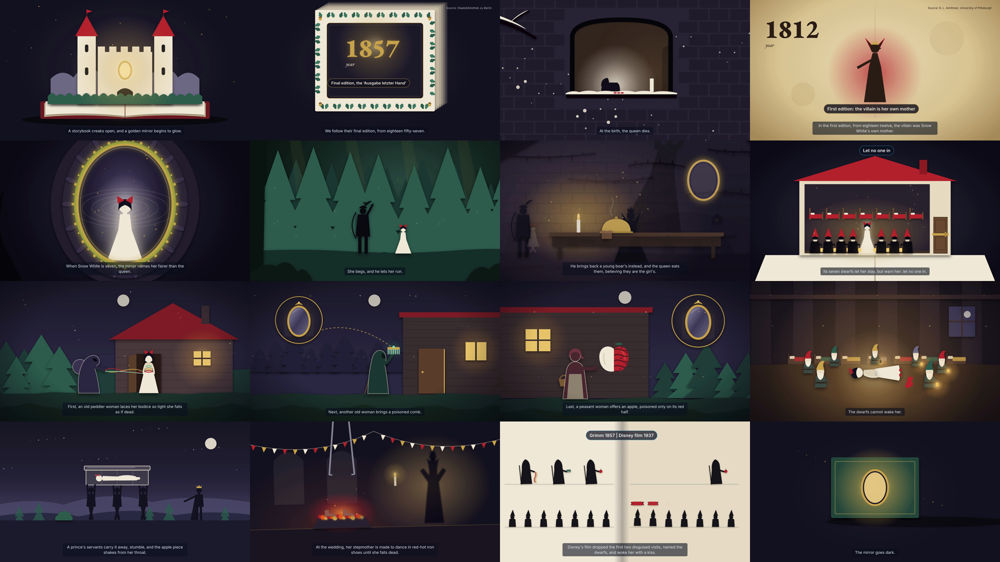

# Traversaal Video Agent

Type a topic, get back a fact-checked, narrated **cinematic explainer** video: a short documentary-style film with animated pictures, camera moves, music, subtitles and a verified source for every fact. A 7-minute film or a 2-minute demo, made end to end by a team of Claude Code agents and rendered with [HyperFrames](https://hyperframes.heygen.com).



*Example: "Tell the story of Snow White as the Brothers Grimm wrote it, for a general audience" (2-minute demo, 117.8 s). Video, script, sources and every intermediate file: [`examples/snow-white/`](examples/snow-white/).*

## Quick start

On a Mac with [Claude Code](https://claude.com/claude-code) (Claude Pro or Max plan) and [Miniconda](https://docs.conda.io/en/latest/miniconda.html):

```bash
git clone https://github.com/vicky-qi/traversaal-video-agent.git
cd traversaal-video-agent
./setup.sh
./start.sh
```

`./start.sh` opens **Traversaal Video Studio** in your browser. Type a topic, choose the length, click **Generate video**. Full instructions and troubleshooting: [INSTRUCTOR.md](INSTRUCTOR.md).

You can also run it inside Claude Code: `/make-video "How do electric vehicle batteries work?" --minutes 7`.

## How it works

| # | Stage | What it does |
|---|---|---|
| 1 | Intake | Turns the topic into a brief: key questions, story spine, art direction |
| 2 | Research | One agent per question, in parallel, collects facts from pages it opened, each with its source |
| 3 | Fact-check | One agent per question verifies every fact against its page and rejects anything overstated |
| 4 | Script | Writes the narration as a three-act story from verified facts only |
| 5 | Voiceover | Records it with a local voice and times every sentence |
| 6 | Storyboard | Plans 4–8 shots per scene: what is seen, the camera move, any label |
| 7 | Final check | Confirms no sentence and no picture says more than the facts |
| 8 | Scenes | One agent per scene, in parallel, animates it in code with HyperFrames |
| 9 | Render | Renders and joins the scenes, then mixes music and sound effects under the voice |

Everything runs on your computer. Beyond the Claude plan, nothing is paid: voice, music, sound effects and rendering are local and free.

## Project layout

| Path | Contents |
|---|---|
| `app/` | The local web app |
| `.claude/agents/` | One agent per stage |
| `.claude/skills/make-video/` | The workflow that runs the stages, with its checking scripts |
| `render/` | Voiceover, render and sound scripts ([render/README.md](render/README.md)) |
| `templates/film/` | Scene shell, animation helpers and a reference scene |
| `docs/` | Script and storyboard formats, visual style, scoring rubric |
| `examples/snow-white/` | A finished run |
| `runs/` | Your runs (kept on your computer, not uploaded) |

Pipeline details for developers: [CLAUDE.md](CLAUDE.md).

## Credits

Julia Low, Jiaxin Wu, Cynthia Jiang, Vicky Qi and Maggie Qu, UCLA Anderson MSBA (MGMTMSA 412), for Traversaal.ai.
